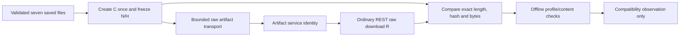

# Producer/service compatibility design: frozen original ZIP

Production integration proposal for review only. The original design checkpoint b058890 introduced no producer transport, service mock, canary workflow or activation. The later fake-only core is described below; it adds no production transport. Operational policy emission stays unconditionally blocked, the reusable sealer stays `if: false`, and Actions stay disabled. Review of this document is not authorization for a hosted test.

Current implementation update: [the network-disabled core and observer](goal6-offline-transaction-core.md) implement only abstract fake messages. The production transport, credential injection and hosted experiment below remain proposals.

## Decision and invariant

Propose a small, independently reviewed raw-ZIP artifact transport owned by a small pinned Node 24 JavaScript action, using built-in HTTPS/crypto primitives. It will follow the artifact protocol observed in the pinned client distribution, without invoking that client's file-to-ZIP API or importing its retry/logging defaults. This is an **unsupported protocol experiment**, not a documented GitHub raw-upload API or an available production route.

The producer first creates **C**, the candidate's FIRST and only archive, from the validated seven saved-evidence files under `CanonicalStoredOriginalZipV1`. This is initial archive creation, not normalization of an existing archive. The transport accepts no existing unsupported artifact ZIP as input for repackaging. Once C is frozen, no phase or recovery path may regenerate, normalize, wrap, replace or revise it. The observer may reconstruct an expected ZIP as a validation oracle, but may never transmit that reconstruction or use it to replace a missing frozen C. A rerun with a new source/run/attempt is a different transaction, never a continuation that silently edits C.

Let `H = SHA256(C)`, `N = length(C)`, and **R** be the raw bytes independently obtained using the ordinary GitHub REST artifact-download route. Compatibility succeeds only when all of the following hold:

- The upload body is exactly C; its independently measured length/hash remain N/H.
- One exact, nonexpired artifact identity is established for the approved repository, workflow, source, run and attempt.
- Authenticated artifact metadata reports `size_in_bytes = N` and `digest = sha256:H`, unchanged across observation.
- `length(R) = N`, `SHA256(R) = H`, and a full byte comparison proves `R == C`.
- R independently passes the existing canonical original-ZIP and seven-file content checks.

A successful Finalize response or a digest supplied by the uploader cannot establish this: the service might echo the submitted hash. Matching extracted files also cannot establish it. A service transformation, even to an equivalent ZIP, is failure; there is no normalization fallback. The eventual sealing subject remains R/C, with its original artifact ID and digest. Any later evidence-upload wrapper has a different identity and cannot substitute for that artifact.

## Why this route needs review

The repository pins `actions/upload-artifact` at `ea165f8d65b6e75b540449e92b4886f43607fa02`. Its [wrapper](https://github.com/actions/upload-artifact/blob/ea165f8d65b6e75b540449e92b4886f43607fa02/src/shared/upload-artifact.ts) invokes the artifact client's file-list upload method. Its [lock file](https://github.com/actions/upload-artifact/blob/ea165f8d65b6e75b540449e92b4886f43607fa02/package-lock.json) resolves `@actions/artifact` 2.3.2. Anonymous inspection of that published package, verified against the lock's SHA512 integrity, shows a file-list-to-ZIP stage before blob upload. Passing `candidate.zip` as a file would therefore create a wrapper. Selecting compression level zero still does not bind all ZIP headers/metadata to our profile.

The same reference distribution shows a separate sequence: CreateArtifact, raw upload stream to a signed blob URL, then FinalizeArtifact with size and optional hash. It also has backend retry defaults, concurrent blob-upload behavior and raw/debug error paths unsuitable for simply importing into the bounded TokenForge client. See [the design record](goal6-producer-zip-design-review.json) for exact distribution/file hashes and inspection limits. No package was installed or executed. A lock-integrity match is distribution linkage, not independent build reproducibility or verification of registry signature/provenance.

GitHub's [public artifact REST documentation](https://docs.github.com/en/rest/actions/artifacts?apiVersion=2022-11-28) documents metadata, download and deletion operations; it does not establish a public create/raw-upload contract for this proposal. The Azure storage steps have documented [Put Block](https://learn.microsoft.com/en-us/rest/api/storageservices/put-block) and [Put Block List](https://learn.microsoft.com/en-us/rest/api/storageservices/put-block-list) semantics, but whether GitHub's returned URL permits this exact sequence and preserves C through its download service remains unproven.

Do not relax the existing ZIP profile to accommodate a service-generated archive. If the raw route is unavailable or the service rewrites bytes, report unsupported/incompatible and return to design review. A different signing-subject protocol would require explicit separate schema/identity review; it is outside this design.

## Proposed components and credentials

**Initial producer.** A reviewed, pinned entry point validates the seven saved public candidate files, constructs C once, validates C with the existing checker and freezes it in a new private 0700 parent, with a read-only file and an immutable in-memory snapshot. It records profile/source/run/attempt, exact N/H and a unique transaction name before any service mutation. Paths, profile and endpoint selectors are code constants, not caller expressions. The synthetic canary uses no tenant evidence, passkeys, sessions or repository secrets.

**Transport and credential boundary.** A future repository-owned JavaScript action owns all bounded transport and REST observation requests, using Node 24 built-in HTTPS/crypto primitives without artifact/blob SDK imports. PowerShell remains the nonsecret producer and canonical/content validator. Runtime credentials stay inside the action process: never transfer them through PowerShell, command arguments, files, output commands, `GITHUB_ENV`, `GITHUB_OUTPUT` or step outputs. The observer is a separate logical component with only the read credential and fixed read routes; its credential-scoped dispatch interface cannot invoke uploader mutations. Only frozen public bytes and sanitized observations cross the validation boundary. The action sends only four allowed mutation types: CreateArtifact, one Put Block containing C, one Put Block List naming that block, and FinalizeArtifact. It proposes artifact protocol version 4 as observed in the pinned reference. Backend workflow/job routing IDs come only from the runner-provided runtime context; decoded token claims are routing hints, not verified artifact authority. Artifact IDs remain exact decimal strings/int64 values, never floating-point JavaScript numbers.

The inspected package reads `ACTIONS_RUNTIME_TOKEN` and `ACTIONS_RESULTS_URL` from its environment; this does **not** prove availability in a plain shell step or even establish this future action's runner contract. Runner injection into the pinned JavaScript action must be established through reviewed runner/action sources and offline environment-contract fixtures before proposing live execution. Missing values, unsupported runner/runtime, or unapproved context/origins must refuse before the first mutation; there is no credential extraction/bootstrap fallback. No new runtime is installed or executed here. Exact action source and runner/Node distribution revisions remain unbound prerequisites.

A single shared dispatch guard charges and durably records every attempt before sending it, enforces origin/method/path/body/deadline/byte limits, forbids redirects except the approved one-hop download, and has no retry or parallel-upload loop. Use a fresh direct HTTP/1.1 connection per request, no shared/reused agent, proxy, automatic authentication negotiation or redirect handler. Pin and test the selected runtime behavior to prevent implicit wire retries, including dropped sockets; a code-level absence of a retry loop alone is insufficient. Every new wire exchange requires its own durable charge, and an unobservable replay path makes the transport unacceptable. Do not call the high-level upload client or its ZIP builder. Do not inherit HTTP-client, blob-SDK, proxy, debug or telemetry defaults. A future implementation must pin its own source, HTTP/API versions and reviewed protocol schemas; inspected upstream versions are references, not a newly approved executable dependency set.

| Destination | Credential | Rules |
|---|---|---|
| Approved Results backend | Ephemeral Actions runtime token | Only Create/Finalize fixed routes; validate origin before reading/sending token; no redirect |
| Approved artifact blob origin | URL's short-lived SAS | One block and its block list only; no GitHub/runtime Authorization header; no redirect |
| `api.github.com` metadata/download redirect | Explicit read-only GitHub job token | Fixed repository/run/artifact routes; preserve existing approved REST API version; no arbitrary caller URL |
| Raw download storage origin | Download URL capability | No GitHub/runtime Authorization header; one successful response, no second redirect |

For the canary, stage one nonce-bound block and commit only that block as `Uncommitted`; do not fall back to `Latest` or reuse existing blocks. Do not set archive Content-Encoding or use transparent request/response content compression. HTTP transfer framing is distinct from archive bytes; R is the unchanged artifact payload.

The Results origin must be separately established and allowlisted before implementation can run; a runner environment value alone is not an allowlist. `https://results-receiver.actions.githubusercontent.com` is a candidate to verify, not an approved operational binding. Storage is initially limited to the reviewed Azure blob-host pattern already used by the sealer; any new host requires review. URLs must be HTTPS/443 without userinfo or fragments. Reject duplicate/operation-smuggling query keys; preserve the supplied SAS query rather than decoding/re-encoding its signature. Add only the fixed block/list operation parameters. Pin an explicit supported storage API version during implementation review; missing version/origin bindings fail before dispatch.

Never persist or log runtime/read tokens, JWTs/claims, SAS/download URLs, raw headers or server/error bodies. Emit fixed stage/reason codes and bounded sanitized metadata only. Role permissions exclude `id-token: write`, `attestations: write` and repository contents-write. Runtime artifact credentials do not authorize tenant access or publication.

**Independent observer.** For the first interoperability experiment, a separate observer component runs in the same isolated job so frozen C remains available for direct comparison. It obtains ordinary REST metadata/download bytes independently of the uploader, validates the expected context, then evaluates all equalities above and repeats metadata/run checks. It does not invoke the signing action or relax the production sealer's main/discovery-workflow checks. Its result kind is an interoperability observation, never an approval, publication policy or sealing attestation. A later production sealer job will independently repeat its existing full authority/origin checks; the producer's receipt is not authority.

## Durable intent and ambiguous outcomes

Use one exclusive, new private transaction directory and a bounded, strict-schema journal with atomic replacement/fsync. Persist C, N/H, source/profile identity, transaction nonce/name, counters, a fixed absolute expiration, elapsed/deadline information and stage intent before any dispatch. Restarts never replenish counters, byte allowances or the original 180-second deadline. Within a process use monotonic remaining time capped by the persisted expiration; on restart refuse clock rollback, inconsistent timing or any inability to prove remaining time. There is no new deadline on recovery. A name includes the approved run/attempt and one durable nonce; do not generate a replacement name after failure. Reopen saved C only if its exact hash/length and transaction identity still match. Do not reopen/rebuild it from mutable source files to transmit a replacement.

| Last durable stage | Next permitted action / result |
|---|---|
| Prepared, no dispatch intent | One Create after all offline checks/budgets |
| Create intent without definitive response | CreateUnknown; no new Create or name; bounded read-only reconciliation or stop |
| Reservation received; no upload intent | One block upload only while same context/deadline and in-memory URL remain valid |
| Block definitively acknowledged | One block-list commit using the same transaction/block ID |
| Block or block-list intent with ambiguous result | UploadUnknown; do not repeat either mutation or advance to Finalize |
| Blob commit definitively acknowledged | One Finalize, after frozen-byte and budget rechecks |
| Finalize intent with lost acknowledgement | FinalizeUnknown; at most one bounded artifact-list reconciliation, followed by normal independent observation if one candidate is found |
| Exact artifact and R==C established | ServiceBytesVerified (or recovered-after-unknown-finalize), preserving prior uncertainty/counters |
| Missing/changed C or journal, expiry, source/run/attempt change, conflicting/paginated candidates | Unknown/refused; no mutation replay |

A zero-match listing does not prove that no reservation/blob/artifact exists. A name match is a lookup hint only: the selected ID must pass complete metadata, candidate identity and byte checks. Multiple matches or pagination stop reconciliation. No automatic delete, overwrite, mutation retry, URL refresh or Create/Finalize replay is included. Count cancelled/timed-out requests conservatively as attempted; exactly-once service effects are not claimed.

The journal provides process-level recovery while that private runner workspace survives. Loss of the hosted runner or frozen C is an explicit Unknown outcome, not durable cross-job recovery. Changed attempts require a new, separately authorized transaction. No raw upload URL is saved to enable mutation resumption after a restart. Retention is not backup, and possible orphaned reservations require separately approved investigation/cleanup.

## Offline implementation gates required next

These are planned tests, not completed tests or implemented behavior:

1. Independent canonical fixtures prove that the exact buffer written as the block body is C. Reject an existing ZIP input offered for normalization, a wrapper, a changed local file and any body/hash/size discrepancy.
2. Fake backend/blob/REST transports are deny-by-default. Assert exact requests and credential separation, no automatic retries/redirects/parallelism/telemetry, and rejection of unknown origins, malformed URLs, secret-bearing errors and invalid response/ID types. Include missing runner-injected credentials, unsupported action/runtime context, and wire-level dropped-socket fixtures that prove no implicit replay.
3. Model the normal path, interruption before/after every durable intent, all four lost-ack cases, cancellation, budget exhaustion, duplicate names, corrupt journals, unavailable C and changed source/run/attempt. No ambiguous stage may reissue a mutation.
4. Simulate a service that echoes the supplied Finalize hash while changing the ZIP, and one that rewrites headers but preserves entries. Both must fail; only exact raw R==C can succeed. Include metadata digest/size/origin/expiry changes between reads and cross-artifact substitution.
5. Test exactly-one-candidate reconciliation, zero/multiple/paginated results, large decimal artifact IDs, expired capabilities, clock rollback and process restart without replenishing counters/deadlines. Do not infer no effect from a missing response.
6. Re-run the existing canonical sealer/policy gate against a matching exact-source kit. Verify Operational still refuses, the production workflow still has a literal false guard, and the new observer cannot emit runtime policy/approval objects. Get independent source review before proposing a hosted experiment.

## Proposed future synthetic canary, not authorization

One artifact transaction, seven tiny synthetic files, one Linux job, no tenant credentials or long-lived repository secrets; only explicitly authorized ephemeral GitHub runtime/read tokens, no OIDC/signing, no publishing/PR/merge and no production sealer activation. The artifact archive is at most **64 KiB**; request one-day retention, subject to observed service limits. The custom producer/observer process has **180 seconds total**, at most **12 dispatched HTTP requests**, at most **four mutation attempts** (one each Create/block/commit/Finalize), at most **eight read exchanges** including the download redirect/storage GET and optional one-page reconciliation, and **2 MiB aggregate request/response bodies**. Control responses are capped at 128 KiB and control request bodies at 8 KiB. Each request is also bounded by ten seconds or the remaining global deadline, whichever is smaller. No new upload transaction is allowed after a stop.

The normal observer uses five metadata GETs (repository, run before/after, artifact before/after) and two download exchanges; one optional listing fits the eight-read allowance. The four mutations plus eight reads fit the twelve-request cap. A hidden extra SDK call, HEAD, retry or redirect must be charged and denied when outside the fixed operation set, not exempted from counting. These are custom-client service limits, not a claim to count all GitHub-runner/platform traffic.

Use a separately reviewed **canary-only branch version of an already registered manual workflow path**, provisionally `.github/workflows/ci.yml`, with exactly one five-minute Linux job and no other build/auth/test matrix. Current cached main already contains that manual path; this does not establish current server registration or permission. GitHub documents a [default-branch workflow availability requirement](https://docs.github.com/en/actions/reference/workflows-and-actions/events-that-trigger-workflows#workflow_dispatch), and its [CLI supports selecting the workflow ref](https://cli.github.com/manual/gh_workflow_run). The controller must confirm the actual workflow ID and exact approved ref/SHA before a single dispatch. If registration/ref selection is unavailable, stop for a separately reviewed source/dispatch plan; do not add automatic triggers, dispatch another workflow or promote/merge source as a workaround. No workflow is modified in this design.

Before any future request to run it, supply an exact implementation/transport/observer commit and dependency/API pins, repository/workflow IDs, canary ref/SHA, origin allowlists, source-kit hashes and passing offline fixture/review receipts. The approved ref must be verified before dispatch and compared against `head_sha` during observation; any unexpected source is failure. Those checks alone cannot prevent a branch changing between verification and execution. Require a separately reviewed exclusive, protected canary ref or an enforceable exclusive operator window that prevents writes through source selection/execution. A nonexclusive branch is a pre-dispatch blocker; post-run detection is not a prevention control. Do not assume dispatch accepts a commit SHA where the documented selector is a branch/tag. No ref-protection or default-branch change is authorized here. Code checkout/materialization must be reviewed and pinned, with no dependency install or hosted compilation. Job setup/runner platform traffic is distinct from the twelve adapter calls; the five-minute hosted job ceiling covers job-level cost.

Hosted control operations are outside that adapter allowance and remain a separate blocking prerequisite: the final approval request must enumerate workflow-ID/ref discovery, Actions settings read/enable, one dispatch, bounded observation and disable/restoration, with their own request/time limits. Do not hide those calls in the twelve-request count or assume dispatch returns a run ID. A lost dispatch response must not cause redispatch; one bounded lookup must find exactly one matching run/ref/nonce or return Unknown. There must be an approved exclusive operator window or reviewed concurrency-safe restoration procedure; do not overwrite another operator's Actions setting. No polling/rerun, automatic trigger, unapproved source promotion or cleanup is implied. The full control procedure is not implemented or authorized here, and no invocation command is supplied.

If eventually approved, acceptance would record one exact artifact ID, C/R N/H plus full-byte equality, profile/source/run/attempt/observer identity, complete sanitized request counters and outcomes, changed/unchanged metadata, preservation of the blocked operational policy and Actions restoration. Keep raw C private; emit only a bounded sanitized summary, not a second artifact upload. If frozen C/primary evidence is lost, return Unknown instead of reconstructing a replacement to pass. A passing observation would establish this specific service path for these exact inputs; it would not establish production permissions, reusable-workflow certificate identity, live collector readiness or general ZIP compatibility.

## Review questions

Review whether the unsupported runtime protocol is acceptable to implement behind fail-closed gates, whether the immutable upload/journal and exact REST observation are sufficient, and whether the proposed workflow/ref route and budgets leave hidden operations. Confirm that no supplied hash, wrapper, regenerated archive, retry or recovery can redefine the original artifact. Implementation, offline fixture review and separate scoped hosted authorization are still required; Operational and hosted activation stay blocked regardless of design disposition.
